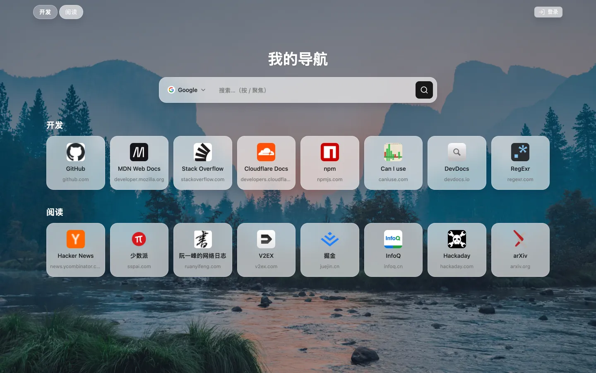
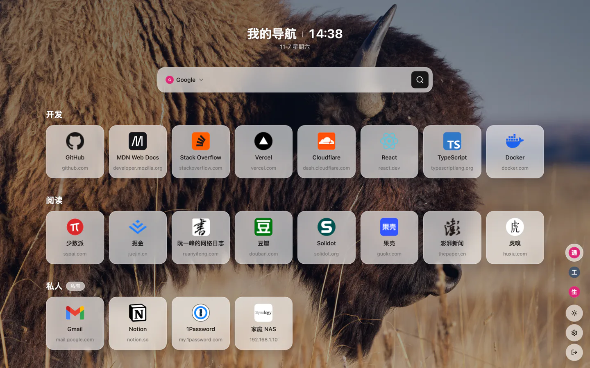
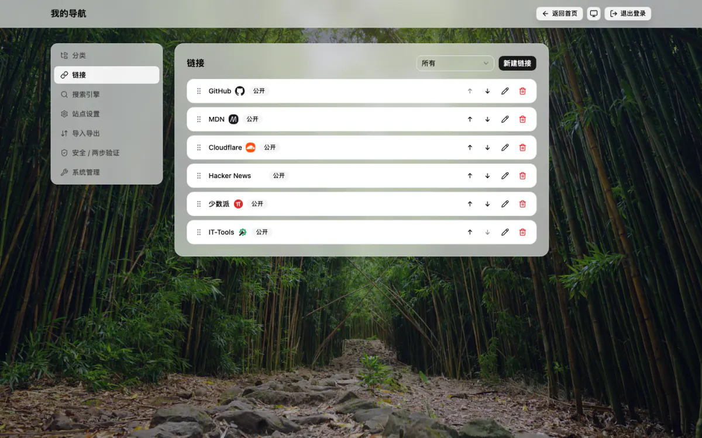

# nav

单人个人导航 / 浏览器起始页（公开 + 私有双层链接）。Cloudflare Workers + D1，域名 `nav.oneboy.app`。

Monorepo：
- `worker/` — Hono Worker 后端（D1 schema 与迁移、鉴权、三组 API、setup 流程）
- `web/` — React + Vite 前端（公共页、后台管理、setup 页）

## 界面预览

首页：全屏壁纸背景上的站点时钟块（站点标题 + 时间）、毛玻璃搜索框与公开导航图标卡片；场景切换、主题与登录入口收在右下角的竖排图标坞里（单图标宽，不占正文宽度）。登录后多出私有分类，后台可管理场景、分类、链接与站点设置。

<p align="center">
  
</p>

| 私有区（登录后）                                                                                                                                                             | 后台管理                                                                                                                                                                                                                                                                                                           |
| ---------------------------------------------------------------------------------------------------------------------------------------------------------------------------- | ------------------------------------------------------------------------------------------------------------------------------------------------------------------------------------------------------------------------------------------------------------------------------------------------------------------ |
|  |  |

## 本地开发

```bash
pnpm install
cp worker/.dev.vars.example worker/.dev.vars   # 填入本地 SESSION_SECRET / SETUP_SECRET
pnpm dev          # 同时起 worker (wrangler dev) 与 web (vite)
```

`worker/.dev.vars` 与真实密钥永不入库（`.gitignore` 已排除）。

`pnpm dev` 的 web 侧是 Vite 开发模式，数据一律走内置 mock（`import.meta.env.DEV`，不请求 `/api/public`）；要连真实 worker 接口（联调、截图）请先 `pnpm build:web`，再由 `wrangler dev` 托管 `web/dist`。

## 测试 / 校验

```bash
pnpm typecheck    # web + worker
pnpm test         # worker 与 web 单测（vitest；worker 用真 SQLite 内存库跑迁移与 API 契约）
pnpm lint         # Biome 代码检查：按 biome.json 的 recommended 规则查代码问题，有 error 即失败、warning 只提示
pnpm format:check # Biome 格式检查：只比对缩进/引号/换行等格式是否合规，不改文件；要自动重排跑 pnpm format
```

## 部署

合并 `main` 后 GitHub Actions（`.github/workflows/deploy.yml`）自动部署 Cloudflare。
凭证不写入代码 / issue / 评论：

**组织级（WorkerHub，已配置）**

| 配置项                  | 类型     | 用途                     |
| ----------------------- | -------- | ------------------------ |
| `CLOUDFLARE_API_TOKEN`  | secret   | wrangler 部署            |
| `CLOUDFLARE_ACCOUNT_ID` | variable | Cloudflare 账户          |
| `D1_DATABASE_NAME`      | variable | 共享 D1 库名             |
| `D1_DATABASE_ID`        | variable | 共享 D1 库 ID            |
| `TABLE_PREFIX`          | variable | 可选：表前缀三态（见下） |

**仓库级（项目私有）**

| Secret           | 用途                       |
| ---------------- | -------------------------- |
| `SESSION_SECRET` | 会话签名密钥（≥16 位随机） |
| `SETUP_SECRET`   | setup 初始化令牌           |

`worker/wrangler.toml` 只保留占位符；部署时 `scripts/materialize-secrets.mjs` 从组织变量注入真实值（真实值不进 wrangler.toml）。

表前缀三态（`TABLE_PREFIX`）：未配置 → 项目默认 `nav_`；`none`（或空）→ 无前缀；其他值 → 原样注入（小写字母/数字/下划线）。

## 初始化（setup）

线上首次部署、库中无账号时开放 setup：`POST /api/auth/setup`（header `X-Setup-Secret`）创建唯一所有者账号，创建后 setup 永久关闭，不设注册接口。响应在 `{ success, user, tablePrefix }` 之外附 `migrations: [{ name, status }]`（`applied` / `skipped`）。

数据库升级/初始化也可走 setup 三件套（SPEC SETUP-PAGE-SPEC v1.0）：
- `GET /api/setup/state`（无鉴权，`no-store`）→ `{enabled, ownerExists, tablePrefix}`；`GET /api/setup/status` 为同逻辑兼容别名。
- `POST /api/setup`（header `X-Setup-Secret`，按 IP 每 10 分钟 3 次）→ **只跑账本迁移**，不建用户/不改密码/不删表；响应 `{success, tablePrefix, migrations, ownerExists}`，前缀冲突 409。
- `POST /api/admin/setup`（会话鉴权、免密钥）、`GET /api/admin/system`、`PUT /api/admin/system/setup-page`：管理面「系统管理」的升级按钮与 setup 页面开关。

setup 页面开关存在 `{prefix}settings.setup_page_enabled`（`'1'` 开 / `'0'` 关，**默认关**：所有者创建成功即写入 `'0'`）：未初始化时页面恒开；开关只门控页面，不门控两个密钥接口本身（密钥即门闩，避免把自己锁在门外）。

## 数据库迁移账本（schema ledger）

schema 的唯一可信源是 `worker/src/lib/migrations.ts` 的 `getMigrations(prefix)` 迁移列表，执行由 `worker/src/lib/migrations-runner.ts` 的 `runMigrations(env)` 完成（setup 路由与读路径 `ensureSchema` 共用同一个 runner）。原 `worker/src/db/schema.sql` + `gen-schema.mjs` codegen 已删除，不再有第二份 schema 定义。

**账本表名**：`_` + 前缀核 + `_schema_migrations`，前缀核即生效 `TABLE_PREFIX` 去掉尾部下划线（大小写原值保留）：

| 生效前缀     | 账本表                      |
| ------------ | --------------------------- |
| `nav_`       | `_nav_schema_migrations`    |
| `app_`       | `_app_schema_migrations`    |
| `abc123`     | `_abc123_schema_migrations` |
| 空（`none`） | `_schema_migrations`        |

表名只由 `migrationsTable(prefix)` 一处生成，不散落拼接。表结构 `name TEXT PRIMARY KEY, applied_at INTEGER NOT NULL DEFAULT (unixepoch())`。

**`schema_v1` 塌缩说明**：nav v1 上线时是裸建表（`CREATE TABLE IF NOT EXISTS` 逐次重放），没有版本历史；本次改造把当前全部 schema（表、索引、`setup_completed` 种子）整体塌缩为一条 `schema_v1`。存量库首次跑 runner 时 `schema_v1` 因 `IF NOT EXISTS` 直接成功并被记账，不需要数据迁移。

**runner 语义**：解析生效前缀 → 防静默切换冲突探测（库中已按其他前缀初始化过就报错，绝不再建第二套）→ 建账本表 → 读取已应用集合 → 按序执行未记录项、成功后立即写一行 → 首个失败即停、报错、失败项不落账、后续不执行。前缀冲突时 setup 返回 409 `{ error: "table prefix conflict", detail }`。

**今后迁移著述规则**：
1. 已合并的迁移名字与 SQL **不可修改**，只能在列表末尾追加（`schema_v2`、`schema_v3`…）。
2. 迁移必须向后兼容、只增不毁：只加表 / 索引 / 列，不删、不改名、不重写存量数据。
3. 破坏性变更须另行立规格（含删表重初始化清单），不走常规迁移。

## API 契约

见 `docs/api-contract.md`（与前端冻结的 DTO 清单）。
